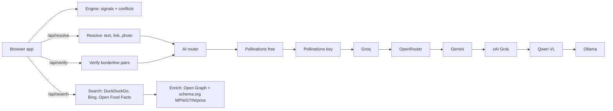
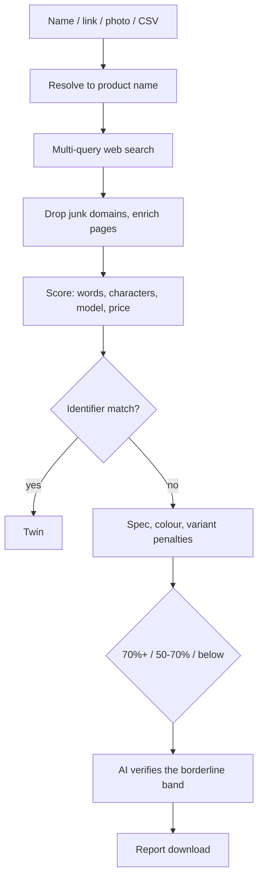

<div align="center">

# TwinTrace
**Product identity workbench. One product, many names.**

[](https://vercel.com/new)
[](https://developer.mozilla.org/docs/Web/JavaScript)
[](https://nodejs.org)
[](https://console.x.ai)
[](https://enter.pollinations.ai)
[](https://aistudio.google.com)
[](https://huggingface.co/Qwen)
[](https://ollama.com)
[](https://world.openfoodfacts.org)
[](https://mermaid.js.org)

</div>

One app, real workflows. **Twin Finder** takes a name, link, photo (upload, paste or camera) or your CSV and runs a goal-specific playbook:

| Playbook | Real-world question | Method |
|---|---|---|
| Price check | Where does my price sit in the market? | median, range, cheapest seller, your gap |
| Counterfeit radar | Which listings look fake or grey-market? | robust outlier test (modified z-score, median/MAD) |
| Catalogue gap check | Does this SKU already exist in my catalogue? | twin match against your CSV |
| Listing audit | What do competitors say that my title does not? | term frequency across twin titles |
| Identify from photo | What is this product, and who sells it? | AI vision, or free on-device OCR fallback |

Also: **Batch Scan** (up to 25 products to a market table), **Catalogue Lab** (bulk clusters, genetic rule learning, accuracy vs baseline, history), **Head to head**, **Guide**. Light and dark themes. Downloads for every result.

## Architecture

## Workflow

## Accuracy features
IDF-weighted scoring (model numbers outweigh common words), spelling-variant model numbers (WH1000XM5 = WH-1000XM5), spec conflicts (128GB vs 256GB), colour and variant (Pro, Max) penalties, schema.org MPN/GTIN identifier match, junk-domain filter, four-query web search, AI check on borderline cases only.

## Run and test
```bash
npm i && npm test          # engine, API and full UI flow tests
npx vercel dev             # run locally
```
Deploy: see [docs/DEPLOY.md](docs/DEPLOY.md). Keys: [.env.example](.env.example). Details: [architecture](docs/ARCHITECTURE.md), [API](docs/API.md), [use cases](docs/USE_CASES.md).

## Environment variables (all optional)
Free routes are tried first, keyed routes are the fallback. Recommended: `POLLINATIONS_API_KEY`, `GEMINI_API_KEY`, `XAI_API_KEY`. Extra: `GROQ_API_KEY`, `OPENROUTER_API_KEY`, `HF_TOKEN`, `OLLAMA_URL`. Better search: `BRAVE_API_KEY` or `GOOGLE_CSE_KEY` + `GOOGLE_CSE_CX`. See `.env.example`. Guide > "Test all AI routes" shows each route's exact status.

## Limits
Web search scrapes public result pages and may be rate-limited; failed sources are shown. Prices come from snippets and page metadata. Free AI tiers should not receive private data. Check the licence of any corpus you load.
