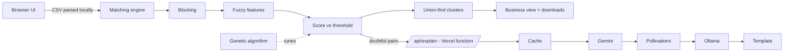
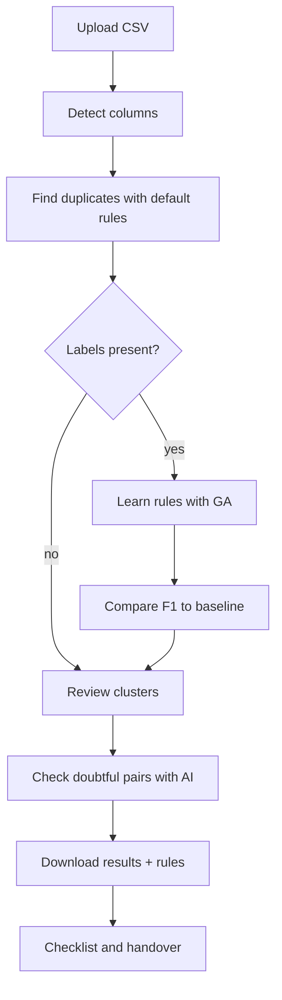

<div align="center">

# TwinTrace
**One product, many names.** Clean a messy product catalogue and see why.

[](https://vercel.com/new)
[](https://developer.mozilla.org/docs/Web/JavaScript)
[](https://nodejs.org)
[](https://ai.google.dev/gemini-api/docs/pricing)
[](https://pollinations.ai)
[](https://ollama.com)
[](https://mermaid.js.org)
[](#llm-fallback-chain)

</div>

## Why it exists
Forward deployed engineers inherit customer catalogues where one product appears under dozens of names. TwinTrace finds the twins, shows the duplicate rate and the price gaps, and proves accuracy against plain text matching, all without paid APIs.

## Twin Finder (main page)
Type a product name, paste a product link, or drop a photo. TwinTrace resolves it to a name, searches the web (DuckDuckGo, Bing, Open Food Facts), opens top pages for image and price, scores every listing, and has a free AI model judge the borderline ones. Optionally upload your own catalogue CSV to check whether the product already exists there. Results download as CSV, JSON or a styled HTML report.

| Input | How the name is obtained |
|---|---|
| Name | used as typed |
| Link | page title read server-side (private addresses are blocked) |
| Photo | vision chain: Gemini (if key) -> Qwen2.5-VL via Hugging Face (if `HF_TOKEN`) -> Pollinations (no key) |

Scoring: word overlap, character overlap, model/spec match, price closeness. Spec conflicts (256GB vs 128GB) and variants (Pro, Max, Ultra) cut the score. Twin 70%+, Likely 50-70%, Different below 50%.

**Catalogue Lab** (`batch.html`) is the bulk tool: upload a CSV, find all duplicate clusters, learn rules with a genetic algorithm, compare runs.

## Features (Catalogue Lab)
- CSV upload with auto column detection (title, price, ground-truth label)
- Blocking to avoid comparing every pair, then fuzzy similarity (word overlap, trigram Dice, model-number match, price closeness)
- Genetic algorithm learns weights and threshold from labelled data
- Precision, recall and F1 against an exact-text baseline
- Business view: duplicate rate and price spread per product
- Doubtful pairs sent to an LLM only when needed, cached, with a free fallback chain
- Downloads: clusters CSV, deduplicated catalogue CSV, business report JSON, rules JSON (re-loadable)
- Light and dark theme (follows your system, switchable, remembered)
- Compare tab: signal-by-signal breakdown of why two listings match, plus web-check links
- Cluster search and size filter, cluster-size chart
- Run history (rules + F1 per run) with CSV export; Markdown report; print to PDF; AI verdicts CSV
- Built-in checklist, glossary and how-to tab

> "Web check" opens a search for the title in a new tab. TwinTrace does not scrape the web.

## Architecture


## Workflow


## LLM fallback chain
`cache -> Gemini (GEMINI_API_KEY, free tier) -> Pollinations (no key) -> Ollama (OLLAMA_URL) -> fixed template`. Nothing is paid. Matching itself never needs a key.

## Run locally
```bash
npm i -g vercel
vercel dev           # serves public/ and /api/explain
```
## Deploy
1. Push this folder to GitHub. 2. Import it in Vercel (no build command; output directory `public`). 3. Optionally add env vars from `.env.example`.

## Limits and risks
- Live web search scrapes public result pages. DuckDuckGo or Bing may rate-limit or change markup; the UI shows which source failed instead of hiding it. Results are only as good as what those pages expose.
- Prices come from snippets and page metadata, so they can be missing or in different currencies.
- Vercel Hobby: 4.5 MB request cap, personal and non-commercial use. Parsing happens in-browser so uploads are not sent to the server.
- Browser handles roughly 20,000 rows per run; slice larger corpora offline.
- The 98M-offers corpus page states no licence. Confirm before using or redistributing its data.
- Free LLM tiers have tight daily limits and should not receive private data. Use Ollama for sensitive catalogues.
- Pollinations and Gemini endpoints can change; the chain falls back to the template if they fail.

## Layout
```
public/index.html   Twin Finder (name / link / photo / CSV)
public/batch.html   Catalogue Lab: bulk dedup, GA, history
api/twin.js         resolve (link, photo) + web search + enrichment
public/sample.csv   labelled demo data
api/explain.js      LLM fallback function
vercel.json
```
